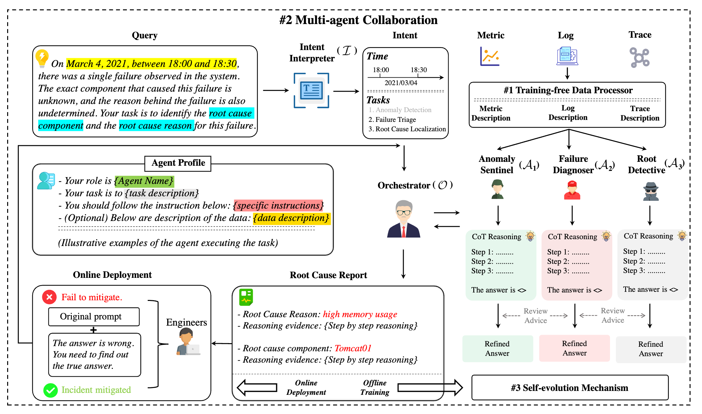

# From Observability Data to Diagnosis: An Evolving Multi-agent System for Incident Management in Cloud Systems
A lightweight, self-evolving multi-agent system for Incident Management (IM) in cloud systems.

# Overview


**OpsAgent** automates end-to-end in incident management in cloud system covering **Anomaly Detection (AD)**, **Failure Triage (FT)**, and **Root Cause Localization (RCL)**, with three core designs:
1. **Training-free Data Processor** that unifies heterogeneous observability data (metrics / logs / traces) into compact, semantically aligned textual descriptions suitable for LLM reasoning.
2. **Multi-agent Collaboration** with role-specialized agents (AD/FT/RCL) and an orchestrator that coordinates cross-review and produces an auditable diagnostic trail.
3. **Self-evolution Mechanism** combining **PPO fine-tuning** (internally) and **reflection** + **RAG** (externally), so capability grows with usage.

# Getting Started

## Environment

OpsAgent requires **Python >= 3.10.**

```
# clone the repository
git clone https://github.com/Johnn13/OpsAgent.git
cd OpsAgent

# Install the remaining dependencies
pip install --upgrade pip
pip install -r requirements.txt
```
> Note: If you use CUDA, install the matching GPU build of `torch` for your driver/toolkit (replace the `torch` line with the command from PyTorch’s selector).

## Dataset

The telemetry data can be download from [Google Drive](https://drive.google.com/drive/folders/1wGiEnu4OkWrjPxfx5ZTROnU37-5UDoPM). Once you have download the telemetry dataset, please put them into the path dataset/.

The directory structure of the data is:

```
.
├── {SYSTEM}
│   ├── test
│       ├── 40_answet_openrca.csv # SOTA
│       ├── 40_query.csv
│       ├── 40_baseline_resut.csv
│   ├── train
│       ├── 60_answet_openrca.csv # SOTA
│       ├── 60_query.csv
│       ├── 60_baseline_resut.csv
│   ├── record.csv
│   └── telemetry
│       ├── {DATE}
│       │   ├── log
│       │   ├── metric
│       │   └── trace
│       └── ... 
└── ...

```
where the `{SYSTEM}` can be Telecom, Bank, or Market, and the `{DATE}` format is `{YYYY_MM_DD}`. We have divided the original query into the test set and the train set according to the ratio of 40/60, and placed them in the test and train directories respectively.

## Configuration

All the configurable parameters are placed in the `.yaml` file under the path configs/.

* `Bank.yaml`, `Market.yaml`, `Telecom.yaml`: Type of instances and failure_types
* `config.yaml`: Multiple file storage path, the most important parameter is model_path

What you need to make sure is: `config.yaml/model_path` and `intent_interpreter.py/model_path` replace with your local LLM path, `config.yaml/dataset` and `config.yaml/query_dataset` are the dataset you want to test.

## Demo
Using following command to run OpsAgent:

```
python main.py
```
